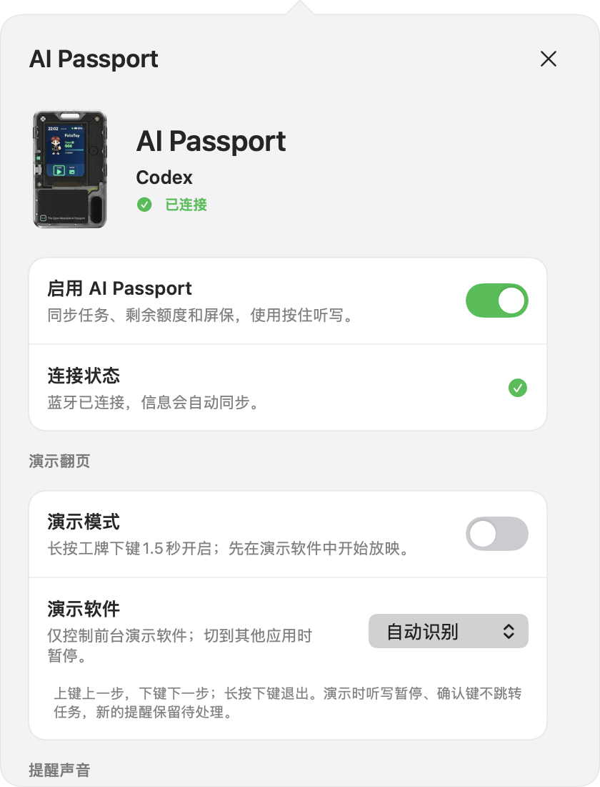

# Codex 语音提醒

**让 Codex 继续工作，有结果时再来喊你。**

一个运行在 Mac 菜单栏里的免费本地提醒工具：任务有结果、等待审批或需要回答时，用声音和卡片通知你。有 AI Passport 工牌时，还能把任务、剩余用量和宠物带在身边，按住工牌确认键向电脑听写；讲课或开会时，还能把它切换为幻灯片翻页遥控器。

[**已发布 Mac 安装包 · v0.9.2-approval.1**](https://github.com/superslash-rico/codex-voice/releases/download/v0.9.2-approval.1/CodexVoice-0.9.2-approval.1-universal.dmg) · [全部下载与固件](https://github.com/superslash-rico/codex-voice/releases/tag/v0.9.2-approval.1) · [AI Passport 入门](docs/AI_PASSPORT.md) · [更新日志](CHANGELOG.md)

**最新源码：`0.10.0-presenter.1`，配套工牌固件 `0.4.0-presenter`，新增幻灯片放映遥控。** 当前已发布的 `v0.9.2-approval.1` 安装包及 `0.3.0-pets` 固件不含翻页功能；体验新功能请按[源码构建](#源码构建与固件开发)和[演示翻页指南](docs/PRESENTATION_MODE.md)部署两端。

> ### ChatGPT / Codex 订阅与充值 → [slashx.shop](https://slashx.shop/)
>
> 需要开通订阅或了解套餐？访问 **[Codex 订阅服务站](https://slashx.shop/)**，查看 ChatGPT / Codex 套餐、购买流程、卡密兑换和售后说明。网站提供选套餐、联系客服购买、回站兑换的使用指引，具体条件与价格以网站为准。
>
> **提醒工具免费使用，订阅服务按需选择。** 该网站为第三方独立服务，非 OpenAI 官方网站。本应用的订阅入口只打开固定网址，不附加你的账号、邮箱、用量或登录凭据。

<p align="center">
  
  
</p>

*以上为真实 SwiftUI 界面的隔离演示数据，未使用个人聊天内容。第三方工具，与 OpenAI 官方产品无隶属关系。*

## 它解决什么问题

长任务运行时，你可以离开聊天界面继续做别的事。需要你接手时再听到提醒；面板区分结果就绪、等待审批、需要回答和异常关注，让你迅速回到对应聊天。**“已接手”只停止提醒，审批和发送仍由你完成。**

| 能力 | 可以怎样使用 |
| --- | --- |
| 本地任务提醒 | 多聊天分别接手、重新播报、稍后提醒、全部接手 |
| Computer Use 应用授权 | 可选识别 Codex 已打开窗口中的应用授权卡片，提醒你允许或拒绝 |
| 可配置声音 | 系统音色、语速、称呼、三档重复间隔、按类别静音或限次 |
| 暂停与免打扰 | 记住暂停时长，支持跨午夜时段和审批例外 |
| Codex 剩余用量 | 菜单栏百分比、首页小圆环、详情大圆环与周期、低额度和重置提醒 |
| 自恢复与登录自启 | 后台服务失败后重试，保留必要状态，登录后启动并重连配件 |
| 可选 AI Passport | 任务和用量同步、实体键接手、电脑与工牌独立播报 |
| 宠物屏保 | 自动跟随 Codex 所选形象；工牌昵称独立配置，新用户默认 **Codex** |
| 幻灯片放映遥控 | 上下键翻页，长按下键切换演示模式；演示中暂缓提醒，切换应用时暂停翻页 |
| 工牌按住听写 | 开始单音后讲话，松开识别，完成双音表示文字已填入；不自动发送 |

**没有工牌也能正常使用。** 只有一个 Mac 软件，硬件是其中的可选配件，不需要再安装“Codex 工牌联调”。

## 新增：幻灯片放映遥控

让 AI Passport 在讲课、会议和产品演示时也派上用场。**电脑端 `0.10.0-presenter.1` + 工牌固件 `0.4.0-presenter`** 复用已有蓝牙连接；电脑仍然只需这一个软件。

<p align="center">
  
  
  
</p>

*电脑画面由真实 SwiftUI 组件渲染，工牌画面由真实 LVGL 固件绘制，均使用演示数据；不是硬件实拍照片。*

1. 先在 **PowerPoint 或 Keynote 中开始放映**，让放映窗口保持在前台。
2. **长按工牌下键约 1.5 秒**，或在 **AI Passport → 演示模式** 中开启。
3. 工牌显示“已连接，可以翻页”后，**短按上键回退、短按下键前进**。有逐步动画时按演示软件自己的顺序推进。
4. **长按下键约 1.5 秒退出**，恢复日常提醒、任务操作和按住听写。

| 场景 | 行为 |
| --- | --- |
| 新任务到来 | 提醒仍进入待处理列表，电脑和工牌暂缓语音播报，电脑面板不自动弹出；工牌只显示数量 |
| 工牌静置变暗 | 第一下一按同时唤醒和翻页，不额外消耗一次按键 |
| 切到其他应用 | 暂停翻页，回到所选演示软件后继续；演示模式仍保持，提醒继续暂缓 |
| 确认键与听写 | 演示中不自动跳转 Codex，听写暂停；退出后恢复 |
| 断开、休眠或重启 | 清除演示模式，恢复后需手动重新开启；不补发旧按键 |

默认自动识别前台演示软件，也可固定选择 PowerPoint、Keynote 或 WPS。**PowerPoint 和 Keynote 已在本机完成翻页验收；WPS 已加入识别和按键适配，但本机未安装，尚未实测。** 复杂动画、真实外接投影及来任务/断连场景仍需专项实测。当前只判断应用身份，不读取幻灯片内容、放映状态或页码；请把焦点留在实际放映窗口。

翻页复用听写所需的辅助功能/事件发送权限，Mac 应用须在后台运行。使用、兼容性和故障处理见[演示翻页指南](docs/PRESENTATION_MODE.md)。

## 下载安装：先让电脑提醒跑起来

### 1. 下载并打开

下列安装包是已发布的提醒版本；幻灯片翻页需要上方说明的最新源码配套版本。

从 [Releases](https://github.com/superslash-rico/codex-voice/releases/tag/v0.9.2-approval.1) 下载 `CodexVoice-0.9.2-approval.1-universal.dmg`，打开后将 **Codex 语音提醒.app** 拖到 **Applications / 应用程序**，再从应用程序启动。也提供 ZIP 和 `SHA256SUMS.txt`。

- 普通提醒、用量及配件同步面向 **macOS 13+**；工牌听写另需 **macOS 26+**。
- 同一安装包包含 **Apple 芯片和 Intel** 两种架构；实机测试为 Apple 芯片 Mac，Intel 和旧系统未实机验收。
- 安装包自带 Python，无需另外安装 Python、Homebrew 或填写 API Key。
- 当前是**尚未完成 Apple Developer ID 签名与公证的测试版**。首次打开可能被 macOS 提示或阻止；先核对仓库来源和 SHA-256，再按系统“隐私与安全”提示处理。安装包不会关闭 Gatekeeper 或移除隔离属性。

下载文件校验示例（在下载目录运行，对照同一 Release 的 `SHA256SUMS.txt`）：

```sh
shasum -a 256 CodexVoice-0.9.2-approval.1-universal.dmg
```

### 2. 连接本机 Codex

1. 点击菜单栏波形图标，进入 **设置 → 连接 Codex**。
2. 阅读说明后安装本地提醒观察器。
3. 在 **Codex CLI 的 `/hooks`** 中审阅并信任这 **5 个观察器**。如未启用 Hooks，按当前 [OpenAI Docs](https://learn.chatgpt.com/docs/hooks) 检查客户端支持和功能设置。
4. 返回工具首页点击 **试听一下**，听到后点 **已接手**。

安装器备份并合并 `~/.codex/hooks.json`，只添加本工具的观察器，不自动写入信任、不修改审批策略。本版当前适配本机同一用户的 Codex；远程、云端、受管环境及特殊审批不保证覆盖，Codex 内部事件格式更新也可能需要适配。

### 3. 选择声音并打开自启

- 首页点击 **扬声器卡片 → 声音输出**，选择 Mac 内置扬声器、已连接的耳机/蓝牙/USB/AirPlay 输出，或跟随系统输出。
- 首页仅保留一个 **提醒总开关**：关闭立即停播并清空当前提醒，再开启只接收新事项。
- **电脑播报**只控制电脑出声；工牌播报在 **AI Passport** 内单独配置，可以单独开启或两边同时开启。
- 在设置中开启 **登录后自动启动**，登录 Mac 后启动；工牌在附近且蓝牙开启时自动重连。Mac 休眠、关机或应用退出时，工牌不能独立接收新任务。
- 点击蓝色 **收起面板**，或点击外部/切换应用，面板收起，后台继续工作。

## 日常使用

### 提醒、接手和专注

首页顺序固定为：**扬声器 → 提醒与待处理 → 剩余用量 → 订阅与充值 → AI Passport**。收到事项时卡片优先显示类别、聊天/项目和下一步。

- **已接手 / 知道了**：停止这一条提醒；实际处理回到原聊天。
- **全部已接手**：只处理点击时显示的提醒，随后收起面板。
- **稍后**：选择 5、15、30 分钟；**暂停**可设为 1–1440 分钟，并记住选择。
- **声音与规则**：调整系统音色、100–300 的语速、称呼和 5–3600 秒的三档间隔。默认首次立即播报，之后 30 / 60 / 180 秒重复。
- **按类型设置提醒**：完成、审批、提问、异常可分别静音、限播 1–99 次或持续提醒，卡片仍保留。
- **定时免打扰**：按本机时间设置每周日期与时段，可跨午夜，默认关闭；允许审批出声的例外仍受总开关和手动暂停约束。

### Computer Use 的“允许使用应用”也能提醒

从 **v0.9.2-approval.1** 起，可在 **提醒设置 → Computer Use 授权提醒** 中启用应用授权卡片识别。**此项默认关闭，升级后请按需手动开启**，并允许本应用的辅助功能/设备控制权限。

它只读识别 Codex 已打开窗口中的“允许 ChatGPT 使用某个应用”卡片，沿用你的审批声音、电脑/工牌输出、暂停与免打扰规则。“已接手”只停止提醒，允许或拒绝仍由你在 Codex 中完成。

这项兼容识别不保证覆盖未展开的后台聊天、其他客户端或未来界面版本；普通命令审批继续使用原有事件流程。详细行为和权限说明见 [应用授权提醒](docs/APPROVAL_COMPATIBILITY.md)。

### 用量：一眼看到还有多少

首页保留小圆环和百分比，点击进入详情再看大圆环、各周期和重置时间。通过本机官方 Codex 的只读账号接口约每分钟同步，多个周期取剩余最少的一项；**不是 Token 消耗统计，也不代表全部付费余额**。

需要本机已安装支持账号用量接口的官方 Codex，并以 ChatGPT 账号登录。未登录、API Key 模式、接口不支持或读数过期时显示 `—`，不影响任务提醒。

默认严格低于 **20%** 时单次提醒，可改为 1–99%，按账号、周期和阈值去重。额度回满且周期推进时可单次播报重置；这是有效读数推断，可能错过已开始消耗的新周期。两类提醒均可独立关闭，遵守总开关、暂停和免打扰。

<p align="center">
  
  
</p>

## 有 AI Passport？把它变成 Codex 配件

支持的是 **FoloToy AI Passport，ESP32-C3、8 MB Flash、无 PSRAM** 的这款硬件，不能只按“也是 ESP32”刷入其他板卡。

按用途选择匹配版本：

| 版本来源 | Mac 工具 | 工牌固件 | 适用范围 |
| --- | --- | --- | --- |
| 当前已发布安装包 | `0.9.2-approval.1` | `0.3.0-pets` | 提醒、用量、宠物与听写，不含演示翻页 |
| 当前仓库源码 | `0.10.0-presenter.1` | `0.4.0-presenter` | 上述能力 + 演示翻页；按源码指南构建两端 |

以下下载步骤对应已发布套件；体验翻页请使用[最新源码构建路线](docs/AI_PASSPORT.md#路线-b让-codex-协助从源码构建)，旧固件不会因为更新 README 自动获得新功能。

1. 下载同一 Release 中的 **`AI-Passport-Codex-0.3.0-pets-full.bin`** 和校验文件。
2. 按 [AI Passport 手把手指南](docs/AI_PASSPORT.md) 核对设备、刷写和首次配对。
3. 在首页 **AI Passport → 启用 AI Passport**，允许蓝牙；在 Mac 配对窗口输入工牌的六位码。
4. 选择电脑、工牌是否播报；默认不启用硬件、不启用工牌语音，不影响普通用户。
5. 宠物昵称新安装默认 **Codex**，支持 1–8 个中文、英文、数字或常用标点，升级保留原昵称。

宠物从本机 Codex 当前选择和可读取的资源同步。内置、本地自定义以及已缓存的云端宠物可自动处理；新形象首次需在 Codex 中完成下载。断线、忙碌或资源不可读时保留旧形象，设置页显示进度或原因。这个适配依赖 Codex 的本地配置/资源格式，不能保证未来版本始终兼容。

**按住听写**：macOS 26+，安装简体中文本机模型，并给本应用辅助功能权限。先点电脑输入框，再长按工牌确认；听到开始单音后讲话，松开处理，上扬双音表示文字已经写入。消息由你发送。详细模型设置、权限、失败恢复和按键操作见指南。

## 升级、权限与排错

先退出旧版，再替换 `/Applications/Codex 语音提醒.app` 并重新打开。保持路径可复用设置、观察器和登录自启；不要同时运行新旧版，不要删除运行数据目录。

| 现象 | 先检查 |
| --- | --- |
| 没有提醒 | 设置中的连接状态；`/hooks` 是否审阅；总开关、暂停、分类规则和免打扰 |
| 电脑没声音 | 声音输出中的电脑播报、选定设备、系统音量；指定设备断开不会自动换扬声器 |
| 用量显示 `—` | 官方 Codex 的登录、账号模式、接口支持及最后同步时间 |
| 找不到工牌 | 配套固件、开机/距离/蓝牙权限；附近先只开一张工牌 |
| 工牌不能翻页 | 电脑端与工牌版本是否同时支持演示；已开启模式、输入权限有效，放映窗口在前台；固定目标是否匹配 |
| 听写不能落字 | macOS 26+、中文模型、输入框焦点、辅助功能权限；安全输入框可能不支持 |
| 升级后听写失效 | 临时签名可能使旧授权失效：在系统“设备控制和数据访问/辅助功能”移除旧项，重新添加当前应用并开启 |
| 想取回未输入的文字 | AI Passport → 按住听写 → 设置 → 查看保留的听写文字；它保留在当前进程内，退出前复制 |

## 本地数据与权限

设置和运行数据位于 `~/Library/Application Support/CodexVoice/`。提醒来自本机 Codex 事件和观察器；用量通过官方客户端只读查询，不自行读取登录令牌、不购买或消耗重置额度。必要的任务元数据和恢复检查点以受限文件权限保存在本机。

启用工牌才申请蓝牙；听写落字及可选的 Computer Use 授权识别需要辅助功能/设备控制权限。授权识别默认关闭，只提取应用名与卡片存续，不保存聊天正文或截图，也不代点审批。音频来自工牌麦克风，通过加密配对的 BLE 传到 Mac，用 Apple 本机语音模型识别，不上传录音、不保存音频文件，也不申请 Mac 麦克风权限。文字写入使用临时剪贴板并尽力恢复原内容；若用户期间复制新内容则保留新剪贴板。

宠物同步读取选中形象对应的配置与本地图片缓存，不读取 Cookie 或认证文件，不保存带签名的下载地址。第三方订阅入口仅在主动点击时打开网站，网页行为遵循网站自身说明。详细数据边界见 [开发与部署说明](docs/DEVELOPMENT.md)。

## 源码构建与固件开发

```sh
git clone https://github.com/superslash-rico/codex-voice.git
cd codex-voice
PYTHONPATH=src python3 -m unittest discover -s tests
python3 scripts/verify_native.py
python3 scripts/build.py --package
python3 scripts/verify_app.py '.build/Codex 语音提醒.app'
python3 scripts/verify_passport_engine.py '.build/Codex 语音提醒.app'
```

Mac 源码构建需要 macOS、Xcode Command Line Tools（包含 macOS 26 SDK）和 Python 3.11+。构建产物在 `.build/`，DMG/ZIP 在 `dist/`；构建脚本解包已固定版本和 SHA-256 的官方 Python 安装器，不向系统安装 Python。

| 位置 | 内容 |
| --- | --- |
| [`src/`](src/) | SwiftUI 菜单栏应用、BLE、听写、宠物同步、Python 提醒引擎 |
| [`tests/`](tests/)、[`scripts/`](scripts/) | 主机检查、双架构构建、包验证、隔离界面渲染 |
| [`firmware/ai-passport/`](firmware/ai-passport/) | 可独立构建的 AI Passport 固件完整源码、BSP、资源、锁定依赖、测试及 AI 开发技能 |
| [`docs/PRESENTATION_MODE.md`](docs/PRESENTATION_MODE.md) | 幻灯片遥控、按键、演示静音、兼容性与验收 |
| [`docs/AI_PASSPORT.md`](docs/AI_PASSPORT.md) | 预编译刷写、源码构建、Codex 协助配置、配对、按键、排错 |
| [`docs/DEVELOPMENT.md`](docs/DEVELOPMENT.md) | 部署架构、权限、打包、数据与维护 |
| [`docs/VALIDATION.md`](docs/VALIDATION.md) | 源码版本的检查、既有发布证据和尚未验证范围 |

AI Passport 固件要求 **ESP-IDF 5.5.3**。在其目录阅读 `AGENTS.md` 和中英文 README，再运行 `./tools/validate.sh`；该流程构建、测试并验证合并镜像，**不会自动刷机**。无需提交系统环境、私有聊天、个人配置或构建缓存。所有发布文件通过 Releases 提供，二进制不进入 Git 源码历史。

## 致谢与许可

- [FoloToy AI Passport](https://github.com/FoloToy/ai-passport)：硬件支持、BSP 和固件基础，保留其 MIT 许可证及来源版本。
- [OpenAI Docs：Hooks](https://learn.chatgpt.com/docs/hooks)、[App Server](https://learn.chatgpt.com/docs/app-server)、[Pets](https://learn.chatgpt.com/docs/pets)。
- Apple AppKit / SwiftUI / CoreBluetooth / SpeechAnalyzer；[Espressif ESP-IDF](https://github.com/espressif/esp-idf)。
- [Python 3.14.8](https://www.python.org/downloads/release/python-3148/) 及所含组件许可证随应用保留；Noto Sans SC 的 SIL OFL 随固件源码保留。

本仓库公开源码；Mac 工具自有代码尚未指定统一开源许可证。第三方代码、字体和资源按各自随附许可证使用；FoloToy 的 MIT 声明不覆盖自定义宠物形象，也不授予 OpenAI 品牌或宠物资源的权利。
