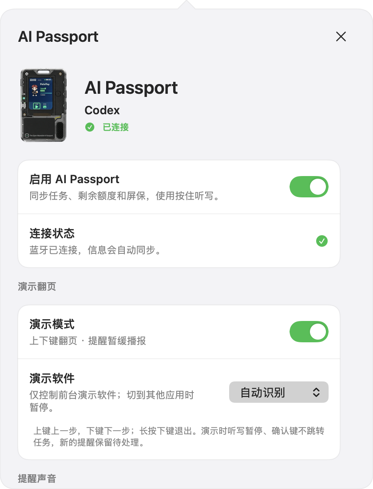

# AI Passport 演示翻页（开发版）

本功能需要电脑端 `0.10.0-presenter.1` 与工牌固件 `0.4.0-presenter`。
本功能已纳入当前仓库源码并完成下述本机验收；预编译安装包尚未发行。公开的 `v0.9.2-approval.1` 安装包与 `0.3.0-pets` 固件不含翻页功能，请按 [AI Passport 源码路线](AI_PASSPORT.md#路线-b让-codex-协助从源码构建)构建并更新两端。

## 使用

1. 保持“Codex 语音提醒”在 Mac 后台运行，并连接 AI Passport。
2. 在 PowerPoint、Keynote 或 WPS 中打开演示文稿并开始放映。
3. 长按工牌下键约 1.5 秒，或在电脑端的 AI Passport 设置中开启“演示模式”。
4. 工牌显示“已连接，可以翻页”后，上键退一步、下键进一步。动画按演示软件自己的顺序推进。
5. 长按下键约 1.5 秒退出；电脑端也可以关闭。原有提醒与听写交互随之恢复。

演示软件默认“自动识别”，也可固定选择 PowerPoint、Keynote、WPS。
自动识别仅依据前台应用身份，不读取幻灯片内容，不判断是否已经开始放映。
请先进入放映，并将焦点留在放映窗口；编辑视图、备注输入框中的方向键行为由演示软件决定。
WPS 当前按 `com.kingsoft.wpsoffice.mac` 识别，其他发行版本的独立进程需另行验证。

## 演示界面

演示时使用深色界面，减少讲课或会议中的亮屏干扰。顶部显示当前演示软件和明确的就绪状态；上下两个控制区对应实体上下键，常用的下一页使用蓝色强调。暂停时控制区变暗，并显示原因。底部只显示暂存的提醒数量，避免展示任务内容。

真实固件绘制预览，使用示例电量和提醒数量；不是实机截图。

  
  

电脑端图片由真实 SwiftUI 视图和隔离演示状态生成。

## 提醒、屏保和按键

- 新任务继续进入待处理列表，但演示期间电脑和工牌暂缓语音播报，电脑端不会自动弹出提醒面板。
- 工牌一直保留演示页面，静置后降低亮度。第一下上下键同时唤醒并翻页。
- 新任务不改变翻页键用途；工牌展示待处理数量，不显示推测的页码。
- 工牌确认键不跳转 Codex；长按确认键的听写在演示模式中暂停，退出后恢复。
- 长按上键仍可进入工牌本地菜单，菜单中的上下键只移动菜单选项。
- 切到其他应用或固定目标不匹配时暂停翻页，演示模式和静音仍保持；返回目标软件后恢复。
- 蓝牙断开、应用重启或 Mac 休眠会退出演示模式。重连后需手动重新开启，不补发断线期间的按键。
- 模式不改变用户的提醒总开关、输出设备、工牌播报开关、暂停截止时间、定时免打扰或开机启动设置。

## 权限与可靠性

翻页复用听写所需的辅助功能／事件发送权限。不安装第二个软件，不改为新的蓝牙 HID 设备。
没有权限时显示暂停状态，不主动弹系统窗口。可以使用已有的“听写设置”或“输入与识别权限”入口授权。

电脑端为当前连接签发 2.5 秒有效的指令凭据，工牌回传启动会话、连接 epoch、递增序号和凭据。
重复、过期、旧会话、错误目标和未静音就绪的请求直接丢弃，均不会延后重试。
按键使用完整的左右方向键按下／松开事件，120 毫秒内的多余事件被丢弃。
发送事件成功不等于验证幻灯片已经切换；本功能不读取实际页码。

演示静音使用电脑端每两秒续期的八秒运行时租约，不写入偏好或恢复记录。
如果原生进程停止续期而提醒引擎仍在运行，租约到期后恢复原先的提醒规则。
退出演示后，仍待处理的任务按既有规则播报；演示中暂缓播报不消耗次数。

## 验收

自动检查覆盖按键时长、屏保与菜单路由、音频互斥、会话／序号／时效校验、前台与权限保护、静音握手、退出和租约到期。
2026-10-29 本机验收：用户已确认 PowerPoint 与 Keynote 的翻页、新界面、变暗后的第一次按键、长按退出，以及退出后的听写直接落字、不弹保留面板、开始单音与完成双音均正常。电脑端开关的入口也已确认。WPS 未安装，尚未实测；复杂动画、外接投影，以及来任务和断连场景的专项实机检查仍待完成，不能由自动测试替代。

开发与刷写方法见 [AI Passport 安装指南](AI_PASSPORT.md)。刷入新固件前需确认设备、已验证文件及数据影响。
